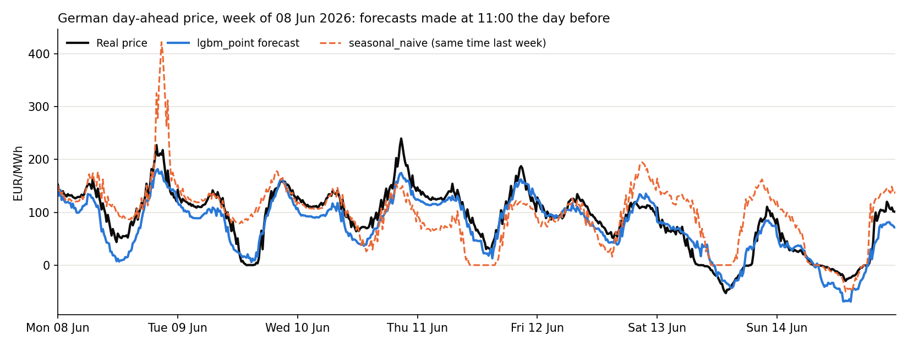

# German power and balancing price forecasting for battery storage

This project forecasts the four German market prices a battery energy storage system (BESS)
earns from: the **day-ahead** energy price and the capacity prices of three balancing reserves,
**FCR**, **aFRR+** and **aFRR-**. Each forecast is made the day before delivery, at the time a
battery operator would have to place its bids, and uses only data that was published by then.
Four models are compared against a simple baseline in a six-month walk-forward backtest.

The forecasts are used by the companion repository
[bess-optimizer](https://github.com/sam96177-rgb/bess-optimizer), which plans a battery on them
and measures how much revenue each forecast model actually earns.

## Results

The baseline, `seasonal_naive`, copies the price of the same period one week earlier.
Error is RMSE (root mean squared error), on the delivery periods every model forecast.

| Market | Baseline | `linear_lags` | `lgbm_point` | `lear` | Best vs baseline |
|---|---|---|---|---|---|
| Day-ahead (EUR/MWh, 15 min) | 62.8 | 40.4 | **36.4** | 39.6 | 42% lower |
| FCR (EUR/MW, 4 h block) | 45.5 | **25.5** | 27.5 | 26.1 | 44% lower |
| aFRR+ (EUR/MW, 4 h block) | 9.8 | 6.9 | 6.4 | **5.7** | 42% lower |
| aFRR- (EUR/MW, 4 h block) | 13.8 | **7.5** | 10.7 | 7.5 | 46% lower |

Test window: 21 March to 17 September 2026 for day-ahead, 4 March to 31 August 2026 for the
reserves.



- Every model beats the baseline in every market. On day-ahead, gradient-boosted trees
  (`lgbm_point`) are best; on the reserve markets the linear models are best.
- Lower error does not always mean more battery revenue. In the
  [bess-optimizer](https://github.com/sam96177-rgb/bess-optimizer) study,
  `lear` had the second-lowest day-ahead error but earned the least from day-ahead trading,
  because it placed the daily highs and lows at the wrong times.
- Limits: one six-month test period, point forecasts only, no significance test between the
  trained models.

## Quickstart

Needs Python (tested with 3.13) and a free ENTSO-E API key: register on the
[Transparency Platform](https://transparency.entsoe.eu/) and create a "Web Api Security Token"
in your account settings.

```bash
python -m venv .venv
.venv\Scripts\activate                     # macOS/Linux: source .venv/bin/activate
pip install -r requirements.txt
copy .env.example .env                     # macOS/Linux: cp; then add your key to .env
```

```bash
python scripts/run_ingest.py               # 1. download the data (cached in data/raw/)
python scripts/run_backtest.py             # 2. backtest all markets and models (~25 min)
python scripts/make_readme_figures.py      # 3. print the results table, draw the figure
streamlit run app/streamlit_app.py         # 4. explore the forecasts in a dashboard
pytest tests/ -q                           # tests (no network or key needed)
```

For a quick first run, limit the backtest, for example
`python scripts/run_backtest.py --markets fcr --models seasonal_naive linear_lags`.
Your API key stays in `.env`, which git ignores.

## How it works

```
 ENTSO-E, regelleistung.net, Open-Meteo
          |  src/ingest/          download and cache prices, generation, weather forecasts
          v
 feature builder                  past prices, calendar, weather, wind/solar forecast
          |  src/features/
          v
 availability filter              drops any input not yet published at the forecast time
          |
          v
 walk-forward backtest            for each delivery day: build inputs at the cutoff,
          |  src/backtest/        predict; retrain every 91 days on all earlier data
          v
 models (one interface)           seasonal_naive, linear_lags, lgbm_point, lear
          |  src/models/
          v
 results/*.parquet                one row per delivery period: forecast and real price
          |
          +--> scripts/make_readme_figures.py   benchmark table and figure
          +--> app/                              Streamlit dashboard
```

**Timing.** Each market has a forecast time one hour before its auction closes, all on the day
before delivery: day-ahead 11:00, FCR 07:00, aFRR 08:00. These times, and when each data
source is published, are set in one file, `config/markets.yaml`.

**No look-ahead.** Every input has a rule for when its value becomes known. Example: for
delivery on Wednesday at 15:00, the day-ahead forecast is made on Tuesday at 11:00. Tuesday's
prices are known (published Monday 13:00), so "same quarter-hour yesterday" is allowed;
anything measured on Tuesday afternoon is not. The filter applies to training data too.

**Models.**

| Model | Idea |
|---|---|
| `seasonal_naive` | Same period one week earlier (the baseline). |
| `linear_lags` | Ridge regression on past prices, calendar, weather and wind/solar forecast. |
| `lgbm_point` | LightGBM gradient-boosted trees on the same inputs. |
| `lear` | LEAR (Lago et al., 2021): one LASSO regression per period of the day, fed with the full price profile of 1, 2, 3 and 7 days earlier. |

A new model is one class with `fit(X, y)` and `predict(X)` (`src/models/base.py`) plus one line
in `src/models/registry.py`; the backtest and dashboard pick it up from there.

**Study settings.** History start, test windows and the model list are in
`config/study.yaml`. A 60-day validation window before each test window is used for choosing
between models, so the test window is never used for any choice.

**Data sources.** ENTSO-E Transparency Platform (day-ahead prices, wind and solar generation),
regelleistung.net (FCR and aFRR auction results), Open-Meteo historical forecast API (weather
forecasts as issued at the time). One assumption to note: ENTSO-E only guarantees the
wind/solar forecast by 18:00 the day before; this project assumes it is available by 07:00.

## Status and next steps

Working and tested (103 tests). The forecasts feed the battery optimiser in
[bess-optimizer](https://github.com/sam96177-rgb/bess-optimizer), which turns them into charge,
discharge and reserve bids. Next:

- forecast the timing of daily highs and lows better, since that is what a battery is paid for;
- add uncertainty bands (quantile forecasts) for risk-aware bidding;
- test on a longer period.

## Licence

View-only: you may read the code and run it unchanged to evaluate it, but not modify, reuse or
redistribute it. See [LICENSE](LICENSE).
